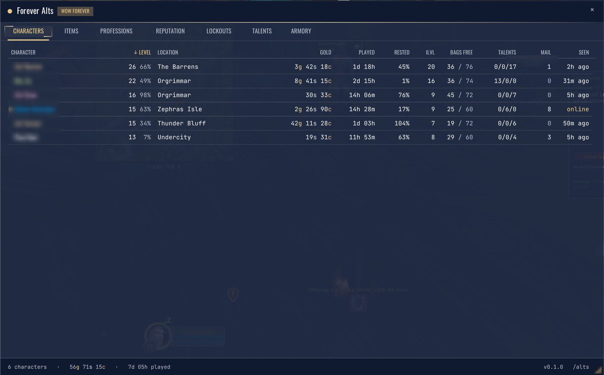
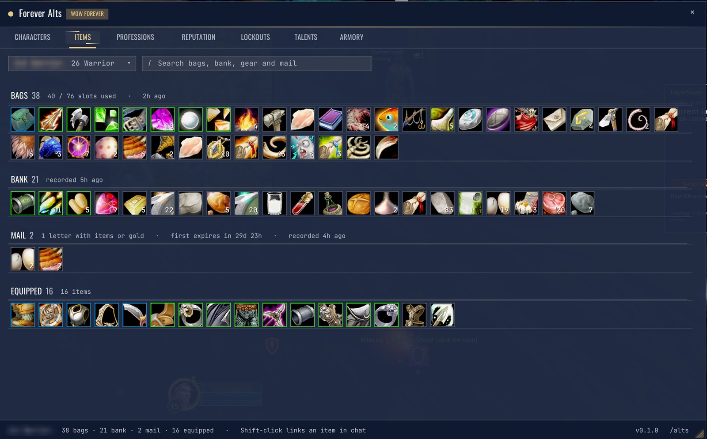
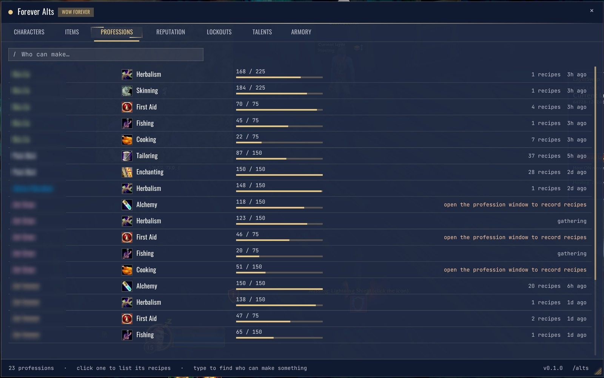
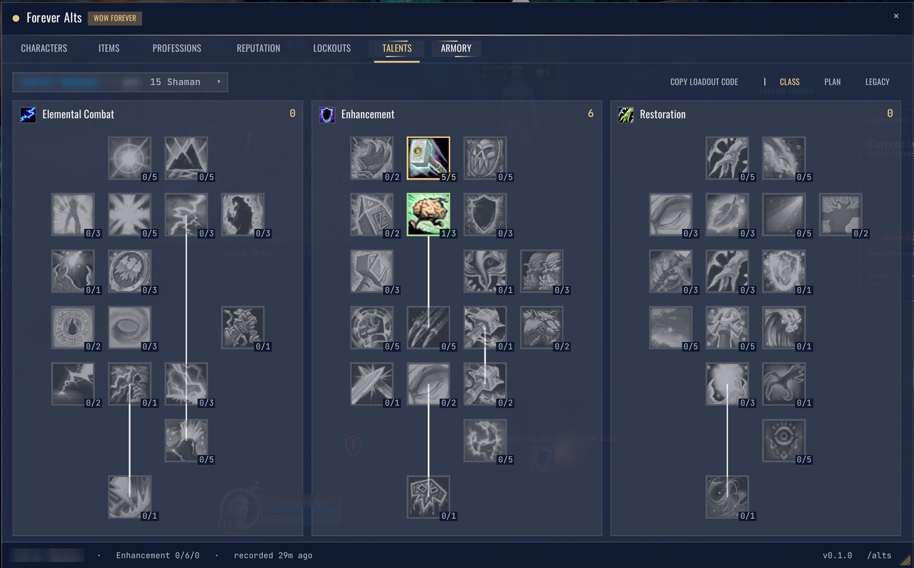
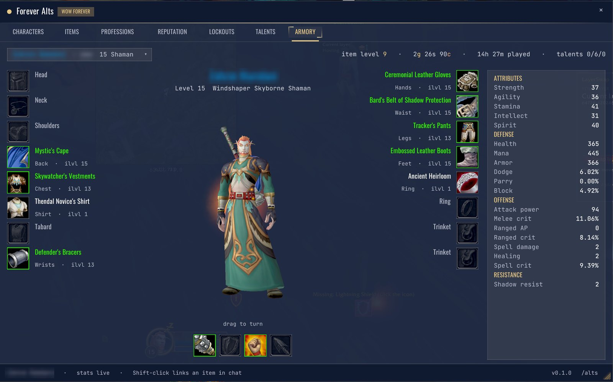

**Every character at a glance, made for WoW Forever.**

Forever Alts records each character you log in on (gold, level, played time, rested XP, bags, bank, gear, mail, professions, reputations, raid lockouts and talents) and shows them all in one window, with item counts on every tooltip. It does the job of Altoholic, with a cleaner look and nothing to set up.

**WoW Forever only** (interface 16001). No libraries.

## Features

- **Characters:** every alt in one sortable table: level, location, gold, played time, rested XP (it keeps counting while they're logged out), item level, free bag slots, mail and when you last played them. Totals for gold and played time.
- **Items:** one search across every character's bags, bank, gear and mail, plus the account bank. Pick a character to browse what they hold.
- **Tooltips:** every item tooltip lists which characters hold it and where, with a total, plus a *Made by* line when one of your characters knows the recipe.
- **Professions:** skill bars and recipe lists for every character. Type a name to find who can make something.
- **Reputation:** every faction any of your characters has met, with each one's standing.
- **Lockouts:** your characters against every raid, with bosses down and when each resets.
- **Talents:** each character's trees as spent, dual spec, a loadout code to copy, and Forever's **Legacy** trees.
- **Talent planner:** named plans per class with Vanilla's rules, the level order to learn them in, a chat reminder when you have points to spend, and a glow on the next talent in the game's own talent window. Share a plan as one line of text.
- **Armory:** a character's gear around their model, with item levels and the character sheet's stats.
- **Mail:** items and gold in each mailbox count everywhere, and a warning at login before mail expires.
- **Minimap button** (left-click: window, right-click: settings, drag to move), which you can turn off.
- **Settings** in the same navy-and-gold look: Esc > Options > AddOns > Forever Alts, or `/alts options`. Window scale 80–150%.

## Getting started

Log in on each character once, and visit a banker and a mailbox once with each. Open a profession window to record its recipes. That's all.

## Slash commands

| Command | Does |
|---|---|
| `/alts` | Open or close the window |
| `/alts items <text>` | Search every character's items |
| `/alts profs <text>` | Find who can make something |
| `/alts reps <text>` | Search factions |
| `/alts talents` / `/alts plan` / `/alts legacy` | Talents, the planner, the Legacy trees |
| `/alts armory` | Gear, model and stats |
| `/alts locks` | Raid lockouts |
| `/alts options` | Settings |
| `/alts minimap` | Show or hide the minimap button |
| `/alts scale <80-150>` | Make the window larger or smaller |
| `/alts reset` | Window back to its usual size, in the middle |
| `/alts help` | The version, the GitHub link and the commands |

To forget a character (deleted or transferred), right-click their row and choose **Forget this character**.

## Help and bug reports

The settings panel shows the installed version, and its **Help and bug reports** button gives you the GitHub address to copy. Source, full documentation and issue tracker: [github.com/paradosi/ForeverAlts](https://github.com/paradosi/ForeverAlts)

Licence: MIT. The bundled fonts (Oswald, JetBrains Mono) are under the SIL Open Font License.
